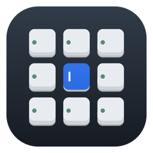

# 설비 원격 접속 (VNC 런처)

설비 목록을 관리하고, 설치된 VNC 뷰어와 Windows 공유폴더를 버튼 하나로 여는 Windows용 프로그램.
파이썬 표준 라이브러리(tkinter)만 사용한다.

- 사용법: [시작하기.txt](시작하기.txt)
- 바로 실행: `실행.bat` (Python 3.10+ 필요) 또는 `python equipment_remote.py`
- exe 만들기: Windows PC에서 `실행판_만들기.bat` → `dist/EquipmentRemote.exe` (이 파일 하나만 배포)
- 테스트: `python -m pytest -q tests`

| 파일 | 내용 |
| --- | --- |
| `launcher/core.py` | 설비 목록 저장(편집 잠금, 날짜별 백업 포함), CSV, 설정, VNC·RDP 명령 구성 |
| `launcher/local.py` | 이 PC에만 남기는 것: 즐겨찾기, 창 크기·위치, 마지막 그룹 |
| `launcher/pack.py` | 배포본: 설정·목록·비밀번호(배포 암호로 다시 암호화)를 exe 끝에 붙인다. `더보기 > 배포본 만들기` |
| `launcher/update.py` | 서버(공유) 폴더를 통한 업데이트: 올리기(`latest.json` + exe), 확인, 받아서 바꾸고 다시 켜기 |
| `launcher/history.py` | 접속 이력 (설비 목록 옆에 달마다 CSV) |
| `launcher/secret.py` | VNC 비밀번호 보관 (Windows DPAPI) |
| `launcher/wintitle.py` | Windows 창 다루기: 뷰어 창 제목, 창 앞으로 가져오기, 화면 크기 |
| `launcher/ui.py` | 화면 |
| `assets/app.ico`, `launcher/icon_data.py` | 프로그램 아이콘 (`python tools/make_icon.py` 로 다시 만든다, Pillow 필요) |

공유 목록(`equipment.json`)에는 설비, 그룹 순서, 주의 표시, 편집 잠금(PIN 해시)이 들어가고,
사람마다 다른 것(`ui_state.json`, `passwords.json`, `config.ini`)은 `%LOCALAPPDATA%\설비원격접속`에 둔다
(exe 옆에 `config.ini`가 이미 있으면 그 폴더). 그래서 exe 하나를 공유 폴더에 두고 여러 사람이 실행해도 된다.

배포는 `EquipmentRemote.exe` 하나다. 사용법과 CSV 양식은 exe 안에 들어 있다(`--add-data`).
부서 공유 목록 경로를 `launcher/site_defaults.py`에 적고 빌드하면 처음 실행할 때 그 경로가 미리 채워진다.
PIN 을 잊으면 `EquipmentRemote.exe --reset-pin`.

`.bat` 파일은 CP949 + CRLF 로 저장해야 한다 (UTF-8 로 저장하면 한글 cmd 에서 깨진다).

## 화면 디자인 원칙

산업용 모니터링 화면(ISA-101 "High Performance HMI" 계열)의 원칙을 따른다.

- 바탕과 정상 상태는 무채색. 색은 **응답 없음(빨강)**, **주의 표시(주황)**, **접속 중(파랑)** 에만 쓴다.
- 정상은 아무 표시 없이 흰 버튼 그대로 둔다 (50대 중 49대가 정상일 때 녹색 점 49개는 소음일 뿐이다).
  이상이 있는 설비만 왼쪽 세로 막대 + 옅은 배경색 + 모양(■ 응답 없음 / ▲ 주의)으로 드러난다.
  색만으로 구분하지 않도록 모양도 다르게 한다.
- 설비 이름은 상태와 상관없이 늘 같은 자리에서 시작해 눈으로 훑기 쉽다.
- 공유폴더·원격 데스크톱 아이콘은 평소 옅게, 마우스를 올린 버튼에서만 진하게.
- 설비 50여 대가 스크롤 없이 한 화면에 들어오도록 버튼 폭을 창에 맞춰 줄이고, 그래도 넘치면 높이를 낮춘다.
- 질감: 은회색 바탕 → 그룹 받침판 → 흰 설비 버튼의 세 겹. 테두리는 가늘게, 그림자는 옅게,
  받침판과 버튼의 모서리는 같은 중심(16 = 6 + 10)을 갖는다. 위쪽 바는 창에 붙이지 않고 띄운다.
- 움직임: 처음 켤 때 그룹이 차례로 떠오르고, 버튼은 마우스를 올리면 1px 뜨고 누르면 내려앉는다.
  색 전환은 모두 빨리 출발해 천천히 멎는 곡선(`ease`)을 쓴다.
- 색 값은 `launcher/ui.py` 맨 위의 상수에 모여 있다.

참고: [Going Gray: A New HMI Standard](https://control.com/technical-articles/going-gray/),
[SoftPerfect PingMonitor tile view](https://www.softperfect.com/products/toolkit/pingmonitor/manual/tile-view.htm),
[Windows 앱 색 지침](https://learn.microsoft.com/windows/apps/design/style/color)
